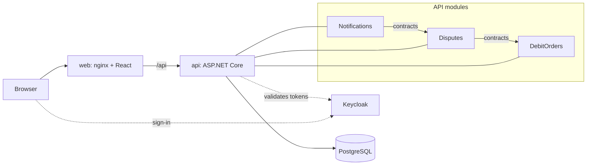
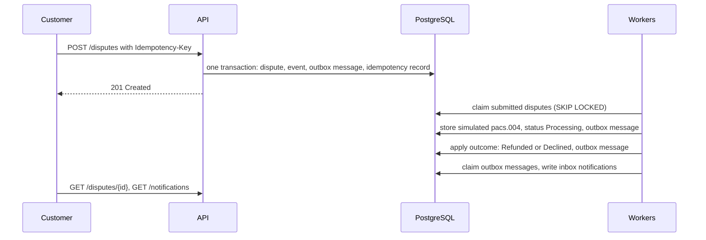

# ACME Bank Dispute Portal API

The back end of a debit order dispute portal for the fictional ACME Bank. A customer signs in, sees the debit orders collected from their account, disputes the ones they are entitled to dispute, and follows each dispute to its outcome. A history view shows pending and completed disputes.

This repository holds the API and everything needed to run the whole system. The web app lives in [dispute-portal-web](https://github.com/majinbruu/dispute-portal-web).

- [What it does](#what-it-does)
- [Tech stack](#tech-stack)
- [Runbook: get it running](#runbook-get-it-running)
- [Five-minute walkthrough](#five-minute-walkthrough)
- [Architecture](#architecture)
- [Dispute rules](#dispute-rules)
- [Using the API](#using-the-api)
- [Develop, build and test](#develop-build-and-test)
- [Configuration](#configuration)
- [Operations](#operations)
- [Troubleshooting](#troubleshooting)
- [Known limitations](#known-limitations)

## What it does

The system plays the role of the **debtor bank**: the bank where the customer holds the account that is debited. A service provider (the creditor) collects a debit order through the payment scheme under a mandate. Everything outside the debtor bank is simulated.

| Feature | Detail |
| --- | --- |
| Debit orders | Paged list of the customer's debit orders with filters for mandate type, status and date range, and sorting by date or amount |
| Mandate types | DebiCheck mandates (authenticated by the customer with their bank) and Registered Mandates (registered by the creditor) |
| Disputability | Worked out when a collection is recorded and shown on every debit order |
| Raise a dispute | One dispute per debit order, with a reason code, safe to retry |
| Dispute history | Pending and completed disputes, each with a time-stamped progress timeline |
| Simulated back office | A background worker sends each dispute "to the scheme" and applies the outcome: refunded or declined |
| Notifications | Every status change produces a message in the customer's in-app inbox, delivered through a transactional outbox |
| Mandates | Read-only lists and details of the customer's mandates |
| Sign-in | OpenID Connect through Keycloak. Each customer sees only their own data |

The brief asks for a system where customers "view transactions and dispute them". This solution narrows "transactions" to debit orders, because that is where disputes have real rules.

## Tech stack

| Area | Choice |
| --- | --- |
| Runtime | .NET 10 (LTS), C# |
| Web framework | ASP.NET Core MVC controllers |
| Data | PostgreSQL 18, Entity Framework Core 10 with Npgsql, one schema and migration set per module |
| Authentication | Keycloak 26, OpenID Connect, JWT bearer validation |
| Validation | FluentValidation |
| API documentation | Built-in OpenAPI document, Swagger UI |
| Observability | Structured JSON logs with trace IDs, health checks, Prometheus metrics from .NET meters |
| Resilience and safety | Transactional outbox, idempotent submission, rate limiting, optimistic concurrency |
| Tests | xUnit, Shouldly, NetArchTest (architecture rules), Coverlet |
| Packaging | Multi-stage Dockerfile on a chiseled non-root image, Docker Compose, Kubernetes manifests |
| CI | GitHub Actions: format check, build with warnings as errors, contract check, tests with a coverage threshold, start-up smoke test against PostgreSQL, image build |

## Runbook: get it running

The whole system (PostgreSQL, Keycloak, API, web app) starts with one Docker Compose command. You only need Git and Docker.

### 1. Install the prerequisites

**Windows** (PowerShell):

```powershell
winget install --id Git.Git --exact
winget install --id Docker.DockerDesktop --exact
```

**macOS** (Homebrew):

```sh
brew install git
brew install --cask docker
```

**Linux**: install Git from your package manager, then Docker Engine with the Compose plugin by following <https://docs.docker.com/engine/install/>.

Start Docker Desktop (Windows and macOS) and wait until it reports that the engine is running. Then check both tools:

```sh
git --version
docker --version
docker compose version
```

Docker needs about 4 GB of memory and 6 GB of free disk for the images and the build.

### 2. Clone both repositories side by side

The Compose file expects the web repository next to this one.

```sh
mkdir dispute-portal
cd dispute-portal
git clone https://github.com/majinbruu/dispute-portal-api.git
git clone https://github.com/majinbruu/dispute-portal-web.git
```

You should now have:

```
dispute-portal/
  dispute-portal-api/
  dispute-portal-web/
```

### 3. Build and start everything

```sh
cd dispute-portal-api
docker compose up --build -d
```

The first run downloads the base images and builds two images, which takes a few minutes. Watch progress with:

```sh
docker compose ps
```

All four services should show `healthy`. Keycloak is the slowest and can take about a minute.

### 4. Open the app

| What | Address |
| --- | --- |
| Web app | <http://localhost:3000> |
| API documentation (Swagger) | <http://localhost:5080/swagger> |
| OpenAPI document | <http://localhost:5080/openapi/v1.json> |
| Keycloak admin console | <http://localhost:8080> (user `admin`, password `local-dev-only`) |

Sign in to the web app with one of the demo customers. All three use the password `AcmeDemo!2026`.

| Username | What you will see |
| --- | --- |
| `thandi` | A full history: 42 debit orders across seven mandates, three existing disputes, notifications |
| `sipho` | A second customer with four debit orders. Use it to see that customers cannot see each other's data |
| `lerato` | No data. Use it to see the empty states |

These are demo credentials for a local demo realm. They exist only in `deploy/keycloak/acme-bank-realm.json`.

### 5. Stop it

```sh
docker compose down
```

To also delete the database so the next start begins from fresh demo data:

```sh
docker compose down -v
```

### If a port is already in use

Copy the example environment file and change the port that clashes:

```sh
cp .env.example .env
```

`WEB_PORT`, `API_PORT` and `KEYCLOAK_PORT` set the host ports. The demo Keycloak realm only allows the web app at `http://localhost:3000`, so if you change `WEB_PORT` you must also change `redirectUris` and `webOrigins` in `deploy/keycloak/acme-bank-realm.json` and recreate the stack with `docker compose down -v`.

## Five-minute walkthrough

Demo dates are generated relative to the day the stack first starts, so these scenarios hold whenever you run it.

1. Sign in as `thandi`. The debit order list opens on **DebiCheck** debit orders.
2. Most DebiCheck debit orders have no **Dispute** button. They match the mandate the customer approved, so they are not disputable.
3. The **MTN South Africa** debit order for R 899,00 has a **Dispute** button. It is above the mandate's maximum collection amount of R 673,50.
4. Switch **Mandate type** to **Registered Mandate**. Recent accepted debit orders can be disputed. The rejected DStv debit order cannot, because no money left the account. Debit orders older than 60 days cannot, because the dispute window has closed.
5. Click **Dispute** on a Vodacom debit order, choose a reason, review and submit.
6. The dispute progress page opens. Within about 30 seconds the timeline moves from **Submitted** to **Processing** to **Refunded** on its own. That is the simulated back office.
7. Open **Disputes** to see pending and completed disputes. One seeded dispute, for Planet Fitness, ends **Declined** because the simulated scheme rejects it.
8. Open the **Inbox** to see the notification for each status change.
9. Open **Mandates** to see the DebiCheck and Registered mandates.
10. Sign out and sign in as `sipho`, then `lerato`, to see data isolation and the empty states.

## Architecture



The API is a **modular monolith**: one deployable, split into three modules with enforced boundaries.

| Module | Owns | Database schema |
| --- | --- | --- |
| `DebitOrders` | Mandates, debit orders, the disputability policy, demo collections | `debit_orders` |
| `Disputes` | Disputes, their events, the processing worker, the outbox | `disputes` |
| `Notifications` | Inbox messages, the outbox consumer | `notifications` |

- A module exposes a small public `Contracts` namespace and keeps everything else `internal`.
- Dependencies run one way: `Notifications` depends on `Disputes` contracts, and `Disputes` on `DebitOrders` contracts. No module reads another module's tables.
- Inside a module, `Domain` has no dependencies, `Application` holds use cases and ports, `Infrastructure` holds EF Core and workers, and `Controllers` holds the API controllers. Controllers are internal like the rest of a module, and the host discovers them through each module's assembly.
- These rules are checked by architecture tests on every build.

**Stateless and safe on many replicas.** Every request carries a token, so any replica can serve it. Background workers claim rows with `SELECT ... FOR UPDATE SKIP LOCKED`, so replicas never process the same dispute or outbox message. The same image runs as an API pod or a worker pod.

**How a dispute flows:**



Design decisions are recorded in [`docs/adr`](docs/adr).

### Project structure

```
src/
  DisputePortal.Api/                    host: composition, auth, rate limiting, health, metrics, OpenAPI
  DisputePortal.SharedKernel/           money, results, paging, problem details, shared conventions
  DisputePortal.Modules.DebitOrders/    Domain, Application, Infrastructure, Controllers, Contracts
  DisputePortal.Modules.Disputes/
  DisputePortal.Modules.Notifications/
tests/
  DisputePortal.UnitTests/              domain rules, use cases with in-memory fakes, validators
  DisputePortal.ArchitectureTests/      module and layer boundary rules
deploy/
  keycloak/                             demo realm, clients and users
  k8s/                                  Kubernetes manifests
  monitoring/                           example Prometheus alert rules
docs/
  adr/                                  architecture decision records
  api/openapi.json                      committed API contract, regenerated on every build
Dockerfile  docker-compose.yml  .env.example
```

## Dispute rules

These are deliberately simplified, portal-side rules. In a real bank the authoritative collection validation and dispute calculation live in downstream payment systems, and a portal displays their result.

**Messages.** Field names follow ISO 20022. A collection request is a pacs.003, its response is a pacs.002 (accepted or rejected), and a dispute is a pacs.004 payment return. The system keeps its own records with those names and stores a simulated pacs.004 payload as JSON on each dispute. It does not produce real ISO XML.

**Disputability under the mandate** is decided once, when the collection is recorded:

| Debit order | Disputable | Why |
| --- | --- | --- |
| Registered Mandate | Yes | The customer never confirmed the mandate with the bank |
| DebiCheck, within the mandate terms | No | The customer authenticated these terms |
| DebiCheck, amount above the mandate maximum | Yes | The collection broke the mandate |
| DebiCheck, wrong day and date adjustment not allowed | Yes | The collection broke the mandate |

**Checked again when a dispute is raised**, because these depend on time and state:

| Condition | Result |
| --- | --- |
| The collection was rejected | Not disputable: nothing was debited |
| More than 60 days have passed | Not disputable: the window is closed |
| A dispute already exists | Not disputable: one dispute per debit order |

**The 60-day window.** Since 13 April 2026 the dispute period for debit orders in South Africa is 60 calendar days, counted from the first calendar day after a successful debit, up to and including day 60 ([PASA Debit Order Dispute Enhancements FAQ](https://pasa.org.za/wp-content/uploads/2026/04/PASA_DODE_FAQ_v3.pdf)). "Today" is the South African calendar date, not the UTC date.

**Dispute reasons:**

| Code | Reason | Allowed for |
| --- | --- | --- |
| `MD01` | I did not authorise this debit order | Registered Mandate only |
| `AM09` | The amount is not what I agreed to | Both |
| `DT01` | It was collected on the wrong date | Both |
| `MD06` | I cancelled this agreement | Both |
| `AM05` | I was debited twice | Both |

**Lifecycle:** `Submitted` → `SentToScheme` (shown to customers as Processing) → `Refunded` or `Declined`. Every transition appends a time-stamped event, which is both the customer's timeline and the audit trail.

## Using the API

Browse and try the API at <http://localhost:5080/swagger>. All paths are under `/api/v1` and need an access token. To call an endpoint from the Swagger page, get a token as shown below, click **Authorize** and paste it.

| Method and path | Purpose |
| --- | --- |
| `GET /debit-orders` | List. Query: `mandateType`, `status`, `from`, `to`, `sort`, `page`, `pageSize` |
| `GET /debit-orders/{id}` | One debit order with its dispute eligibility |
| `GET /mandates`, `GET /mandates/{id}` | Mandates. Query: `type`, `page`, `pageSize` |
| `GET /dispute-reasons` | Reasons, optionally for a `mandateType` |
| `POST /disputes` | Raise a dispute. Needs an `Idempotency-Key` header |
| `GET /disputes`, `GET /disputes/{id}` | History (`state=Pending` or `Completed`) and detail with timeline |
| `GET /notifications`, `GET /notifications/unread-count` | Inbox |
| `POST /notifications/{id}/read` | Mark as read |

**Conventions**

- Lists return `items`, `page`, `pageSize`, `totalItems`, `totalPages`. `pageSize` defaults to 20 and is capped at 100.
- Errors are RFC 9457 problem documents with a stable `code` and a `traceId`.
- Status codes: 400 invalid input, 401 no or bad token, 404 not found or not yours, 409 already disputed or idempotency key reused, 422 not disputable, 429 rate limited.
- A resource that belongs to another customer returns 404, so its existence is not revealed.
- `POST /disputes` is idempotent: the same key and body returns the original dispute, and a unique index on the debit order is the final guard against a double submission.

### Call it from the command line

The demo realm includes a client, `dispute-portal-cli`, that allows the password grant so the API can be called without a browser. It is for local demonstration only.

Bash:

```sh
TOKEN=$(curl -s http://localhost:8080/realms/acme-bank/protocol/openid-connect/token \
  -d grant_type=password -d client_id=dispute-portal-cli \
  -d username=thandi -d 'password=AcmeDemo!2026' -d scope=openid \
  | sed -E 's/.*"access_token":"([^"]+)".*/\1/')

curl -s -H "Authorization: Bearer $TOKEN" \
  "http://localhost:5080/api/v1/debit-orders?mandateType=Registered&pageSize=5"
```

PowerShell:

```powershell
$token = (Invoke-RestMethod -Method Post http://localhost:8080/realms/acme-bank/protocol/openid-connect/token -Body @{ grant_type = 'password'; client_id = 'dispute-portal-cli'; username = 'thandi'; password = 'AcmeDemo!2026'; scope = 'openid' }).access_token

Invoke-RestMethod "http://localhost:5080/api/v1/debit-orders?mandateType=Registered&pageSize=5" -Headers @{ Authorization = "Bearer $token" }
```

Raise a dispute (Bash). Replace the ID with a debit order whose `eligibility.canDispute` is `true`:

```sh
curl -s -X POST http://localhost:5080/api/v1/disputes \
  -H "Authorization: Bearer $TOKEN" -H "Content-Type: application/json" \
  -H "Idempotency-Key: demo-$(date +%s)" \
  -d '{"debitOrderId":"00000000-0000-0000-0000-000000000000","reasonCode":"AM09"}'
```

## Develop, build and test

Docker is all you need to run the system. To work on the code you also need the .NET 10 SDK.

**Windows:**

```powershell
winget install --id Microsoft.DotNet.SDK.10 --exact
```

**macOS:**

```sh
brew install --cask dotnet-sdk
```

**Linux:** see <https://learn.microsoft.com/dotnet/core/install/linux>.

### Build and test

```sh
dotnet restore DisputePortal.sln
dotnet build DisputePortal.sln
dotnet test DisputePortal.sln
```

The build treats warnings as errors and regenerates `docs/api/openapi.json`.

Tests with the coverage threshold that CI enforces (80% of lines in domain and application code):

```sh
dotnet test tests/DisputePortal.UnitTests /p:CollectCoverage=true /p:Threshold=80 /p:ThresholdType=line /p:ThresholdStat=total "/p:Include=[DisputePortal.Modules.*]DisputePortal.Modules.*.Domain.*%2c[DisputePortal.Modules.*]DisputePortal.Modules.*.Application.*%2c[DisputePortal.SharedKernel]DisputePortal.SharedKernel.*" "/p:Exclude=[*]DisputePortal.SharedKernel.Web.*"
```

Check and fix formatting:

```sh
dotnet format DisputePortal.sln --verify-no-changes
dotnet format DisputePortal.sln
```

### Run the API from source

Start Keycloak from Compose and a PostgreSQL container that publishes its port, then run the API. In the Development environment it applies migrations and loads the demo data on start-up.

```sh
docker compose up -d keycloak
docker run -d --name dispute-portal-dev-db -p 5432:5432 -e POSTGRES_DB=dispute_portal -e POSTGRES_USER=dispute_portal -e POSTGRES_PASSWORD=local-dev-only postgres:18-alpine
dotnet run --project src/DisputePortal.Api
```

The API listens on <http://localhost:5080>. Remove the database container when you are done:

```sh
docker rm -f dispute-portal-dev-db
```

### What the tests cover

| Suite | Covers |
| --- | --- |
| Unit tests | The disputability policy and the 60-day boundary, the dispute state machine, idempotent submission and its race, processing outcomes, outbox delivery and retry, notifications, validators, money and paging |
| Architecture tests | Module boundaries, layer direction, and that only contracts are public |

The suites are unit tests only. See [Known limitations](#known-limitations) for what that leaves out.

### Change the database schema

```sh
dotnet tool restore
dotnet ef migrations add <Name> --context DisputesDbContext --project src/DisputePortal.Modules.Disputes --startup-project src/DisputePortal.Api --output-dir Infrastructure/Migrations
```

Use `DebitOrdersDbContext` or `NotificationsDbContext` with their module projects for the other schemas.

### Change the API contract

Building the API regenerates `docs/api/openapi.json`. Commit it with the change; CI fails if the committed contract is out of date. Then copy it to `api/openapi.json` in the web repository and run `npm run generate:api` there.

## Configuration

Settings come from `appsettings.json` and environment variables. In an environment variable, replace `:` with `__`, for example `Auth__Authority`.

| Setting | Default | Purpose |
| --- | --- | --- |
| `ConnectionStrings:Postgres` | none | PostgreSQL connection string |
| `Auth:Authority` | `http://localhost:8080/realms/acme-bank` | Issuer that tokens must carry. This is the public URL the browser uses |
| `Auth:MetadataAddress` | empty | Where the API fetches signing keys, when that differs from the public URL |
| `Auth:Audience` | `dispute-portal-api` | Audience that tokens must carry |
| `Auth:RequireHttpsMetadata` | `true` | Set to `false` only for local HTTP |
| `Database:MigrateOnStartup` | `false` | Apply migrations when the process starts |
| `Seed:Enabled` | `false` | Load demo data when the database is empty |
| `Workers:Enabled` | `true` | Run the background workers in this process |
| `Workers:SendDelaySeconds` | `10` | How long a dispute waits before it is sent |
| `Workers:OutcomeDelaySeconds` | `20` | How long the simulated scheme takes to answer |
| `Simulator:RejectReturnsForTransactionIds` | one demo ID | Collections whose dispute the simulated scheme declines |
| `RateLimiting:RequestsPerMinute` | `300` | General limit per customer |
| `RateLimiting:DisputeSubmissionsPerMinute` | `5` | Limit on raising disputes per customer |
| `Workers:IdempotencyKeyRetentionHours` | `24` | How long an idempotency key is kept before the hourly clean-up deletes it |
| `ApiDocs:Enabled` | `false` | Serve the OpenAPI document and Swagger UI. Docker Compose and the `Development` environment switch it on |
| `AllowedHosts` | `localhost` | Host names the API answers to, separated by `;`. Requests for any other host get a 400 |

Command-line switches: `--migrate-only` applies migrations and exits, and `--healthcheck` probes the running instance and sets the exit code, which the container health check uses.

## Operations

| Endpoint | Purpose |
| --- | --- |
| `GET /health/live` | The process is up |
| `GET /health/ready` | The process can reach its database |
| `GET /metrics` | Prometheus metrics: HTTP, runtime, and business counters such as `disputeportal_disputes_submitted`, `disputeportal_disputes_completed`, `disputeportal_outbox_dispatched` and `disputeportal_outbox_abandoned` |

Health and metrics are served by the API only. The web container does not proxy them.

An outbox message that fails five times is abandoned: it is logged at critical level and counted in `disputeportal_outbox_abandoned`. [`deploy/monitoring/alerts.yaml`](deploy/monitoring/alerts.yaml) has an example alert on that counter, with the query to find the message and how to replay it.

Logs are JSON on standard output, and each line carries the trace ID that also appears in error responses. View them with:

```sh
docker compose logs -f api
```

### Kubernetes

`deploy/k8s` holds manifests for the API: a migration job, an API deployment with probes and an autoscaler, a worker deployment from the same image, a service and a pod disruption budget. Containers run as non-root with a read-only file system.

```sh
kubectl apply -k deploy/k8s
```

The manifests are validated against the Kubernetes schemas. They have not been applied to a cluster, the image they reference is not published, and they do not include an ingress, network policies or the web app. Create the secret described in `deploy/k8s/secret.example.yaml` first.

## Troubleshooting

| Symptom | Cause and fix |
| --- | --- |
| `docker compose up` fails with "path not found" for the web build | The web repository is not next to this one. Clone it there, or set `WEB_CONTEXT` in `.env` |
| A port is already allocated | Another program uses 3000, 5080 or 8080. See [If a port is already in use](#if-a-port-is-already-in-use) |
| The web app shows the sign-in screen again after a page reload | Expected. Tokens are kept in memory only. One click signs back in through the Keycloak session |
| Sign-in works but every API call returns 401 | The token issuer does not match `Auth:Authority`. Use `http://localhost:3000` and `http://localhost:8080` exactly, not `127.0.0.1` |
| Raising a dispute returns 429 | The limit is five submissions a minute per customer. Wait a minute |
| The first start is slow | Keycloak imports the demo realm on first start. `docker compose ps` shows when it is healthy |
| Demo dates look stale | Dates are relative to the first start. Run `docker compose down -v` and start again |

## Known limitations

- **Unit tests only.** There are no automated integration or browser tests. Database behaviour (the unique index, `SKIP LOCKED`, migrations), the real sign-in flow and the pages against the real API were verified by hand and by the CI start-up smoke test, not by a test suite. Integration tests against a real PostgreSQL container are the first thing to add.
- **Simplified rules.** The DebiCheck date rule compares the day of the month, which is correct for monthly mandates only. Real disputability is calculated by scheme and core banking systems.
- **Simulated scheme.** There is no real ISO 20022 messaging and no money moves. The outcome of a dispute is decided by a simulator.
- **Rate limits are per instance.** With several replicas the effective limit multiplies. Production would enforce limits at the gateway.
- **Notification order.** Delivery is at least once and idempotent. With several worker replicas, two notifications for one dispute can be created slightly out of order.
- **Demo identity setup.** Keycloak runs in development mode over HTTP with an embedded database, demo passwords are committed, and the `dispute-portal-cli` client allows the password grant.
- **Error fields are not in the contract.** The `code` and `traceId` fields on error responses are returned but not declared in the OpenAPI document.
- **Kubernetes manifests are not cluster-tested**, as described above.

## Tooling

This project was built with AI assistance (Claude Code). Commits written with the assistant carry a co-author trailer.
