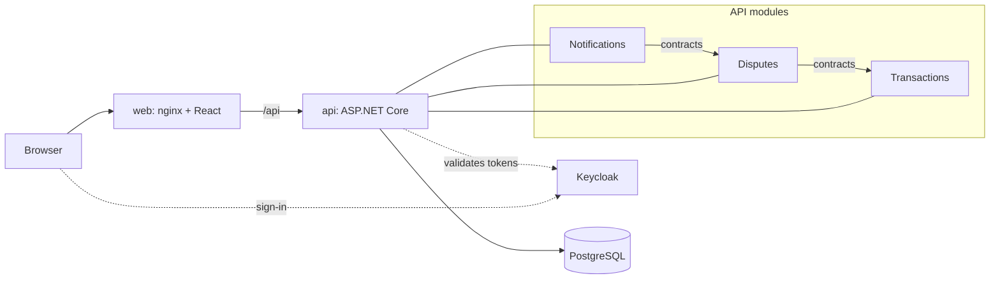
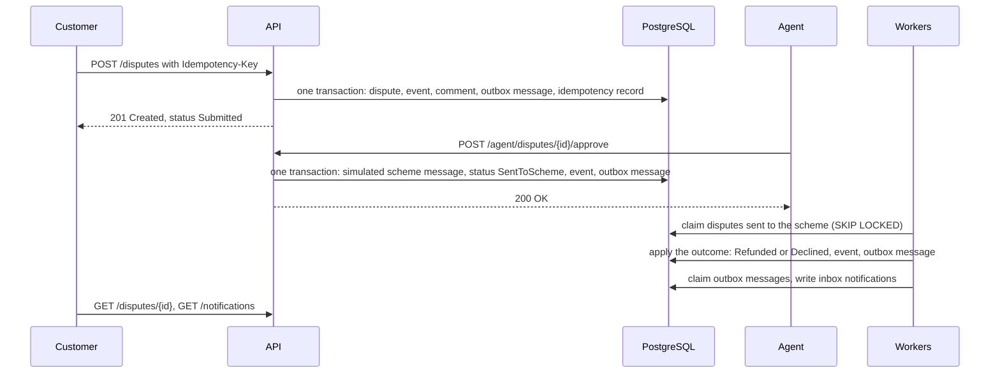
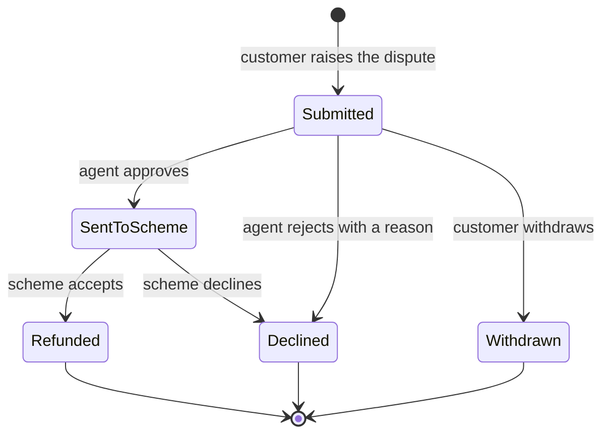

# ACME Bank Dispute Portal API

The back end of a transaction dispute portal for the fictional ACME Bank. A customer signs in, sees the debit orders and card transactions on their account, disputes the ones they are entitled to dispute, and follows each dispute to its outcome. A bank agent reviews each dispute and approves or rejects it. Customer and agent can talk to each other in a comment thread on the dispute.

This repository holds the API and everything needed to run the whole system. The web app lives in [dispute-portal-web](https://github.com/majinbruu/dispute-portal-web).

- [What it does](#what-it-does)
- [Tech stack](#tech-stack)
- [Runbook: get it running](#runbook-get-it-running)
- [Other ways to run it](#other-ways-to-run-it)
- [Ten-minute walkthrough](#ten-minute-walkthrough)
- [Architecture](#architecture)
- [Dispute rules](#dispute-rules)
- [Using the API](#using-the-api)
- [Develop, build and test](#develop-build-and-test)
- [Configuration](#configuration)
- [Operations](#operations)
- [Troubleshooting](#troubleshooting)
- [Known limitations](#known-limitations)

## What it does

The system plays the role of the customer's own bank: the bank that holds the account a debit order is collected from, and that issued the customer's card. Everything outside that bank (creditors, merchants, the payment schemes) is simulated.

| Feature | Detail |
| --- | --- |
| Transactions | Two types, never mixed in one list: debit orders and card transactions. Paged lists with filters for status and date range, and sorting by date or amount |
| Debit orders | Three kinds, also never mixed in one list: DebiCheck (the customer authenticated the mandate with the bank), Registered Mandate (registered by the creditor) and EFT (no mandate held by the bank) |
| Card transactions | Visa and Mastercard purchases and cash withdrawals, with how the card was used and how the cardholder was verified |
| Disputability | Worked out when a transaction is recorded and shown on every transaction, with the last day it can be disputed |
| Raise a dispute | One open dispute per transaction, with a reason offered for that transaction and an optional comment. Safe to retry |
| Agent review | Every dispute waits for a bank agent, who approves it (it is sent for processing) or rejects it with a reason |
| Withdraw | The customer can withdraw a dispute while it still waits for review, and can dispute the same transaction again later |
| Comments | A comment thread on each dispute, open to the customer and to agents while the dispute is open |
| Dispute history | Pending and completed disputes, each with a time-stamped timeline that says whether the customer, an agent or the system caused each step |
| Simulated scheme | After approval a background worker applies the scheme's answer: refunded or declined |
| Notifications | Every status change, and every comment from an agent, produces a message in the customer's in-app inbox, delivered through a transactional outbox |
| Mandates | Read-only lists and details of the customer's DebiCheck and Registered mandates |
| Sign-in and roles | OpenID Connect through Keycloak. A customer sees only their own data. An agent sees the dispute queue across all customers and nothing else |

## Tech stack

| Area | Choice |
| --- | --- |
| Runtime | .NET 10 (LTS), C# |
| Web framework | ASP.NET Core MVC controllers |
| Data | PostgreSQL 18, Entity Framework Core 10 with Npgsql, one schema and migration set per module |
| Authentication | Keycloak 26, OpenID Connect, JWT bearer validation, one authorisation policy per role |
| Validation | FluentValidation |
| API documentation | Built-in OpenAPI document, Swagger UI |
| Observability | Structured JSON logs with trace IDs, health checks, Prometheus metrics |
| Resilience and safety | Transactional outbox, idempotent submission, rate limiting, optimistic concurrency |
| Tests | xUnit, Shouldly, NetArchTest (architecture rules), Coverlet, Testcontainers (integration tests against a real PostgreSQL) |
| Packaging | Multi-stage Dockerfile on a chiseled non-root image, Docker Compose, Kubernetes manifests |
| CI | GitHub Actions: format check, build with warnings as errors, contract check, architecture and unit tests with a coverage threshold, integration tests, start-up smoke test, image build, image publishing to GitHub Container Registry |

## Runbook: get it running

The whole system (PostgreSQL, Keycloak, API, web app) starts with one Docker Compose command from this repository alone. The API and web images are pulled from GitHub Container Registry, where CI publishes them. You only need Git and Docker.

### 1. Install the prerequisites

**Windows** (PowerShell):

```powershell
winget install --id Git.Git --exact
winget install --id Docker.DockerDesktop --exact
```

**macOS** (Homebrew):

```sh
brew install git
brew install --cask docker
```

**Linux**: install Git from your package manager, then Docker Engine with the Compose plugin by following <https://docs.docker.com/engine/install/>.

Start Docker Desktop (Windows and macOS) and wait until it reports that the engine is running. Then check both tools:

```sh
git --version
docker --version
docker compose version
```

Give Docker about 4 GB of memory and a few gigabytes of free disk for the four images.

### 2. Clone this repository

```sh
git clone https://github.com/majinbruu/dispute-portal-api.git
cd dispute-portal-api
```

### 3. Start everything

```sh
docker compose up -d
```

The first run downloads the images. Watch progress with:

```sh
docker compose ps
```

All four services should show `healthy`. Keycloak is the slowest and can take about a minute.

### 4. Open the app

| What | Address |
| --- | --- |
| Web app | <http://localhost:3000> |
| API documentation (Swagger) | <http://localhost:5080/swagger> |
| OpenAPI document | <http://localhost:5080/openapi/v1.json> |
| Keycloak admin console | <http://localhost:8080> (user `admin`, password `local-dev-only`) |

Sign in to the web app with one of the demo users. All four use the password `AcmeDemo!2026`.

| Username | Role | What you will see |
| --- | --- | --- |
| `thandi` | customer | A full history: 47 debit orders (DebiCheck, Registered Mandate and EFT), 11 card transactions, seven mandates, nine disputes in every status, notifications |
| `sipho` | customer | A second customer with four debit orders, three Mastercard transactions and one dispute. Use it to see that customers cannot see each other's data |
| `lerato` | customer | No data. Use it to see the empty states |
| `zanele` | agent | The dispute queue across all customers. An agent is not a customer and has no transactions |

These are demo credentials for a local demo realm. They exist only in `deploy/keycloak/acme-bank-realm.json`.

### 5. Stop it

```sh
docker compose down
```

To also delete the database so the next start begins from fresh demo data:

```sh
docker compose down -v
```

### If a port is already in use

Copy the example environment file and change the port that clashes:

```sh
cp .env.example .env
```

`WEB_PORT`, `API_PORT` and `KEYCLOAK_PORT` set the host ports. The demo Keycloak realm only allows the web app at `http://localhost:3000`, so if you change `WEB_PORT` you must also change `redirectUris`, `webOrigins` and `post.logout.redirect.uris` in `deploy/keycloak/acme-bank-realm.json` and recreate the stack with `docker compose down -v`.

## Other ways to run it

### Build both images from source

`docker-compose.build.yml` replaces the two pulled images with images built from source. It expects the web repository next to this one.

```sh
mkdir dispute-portal
cd dispute-portal
git clone https://github.com/majinbruu/dispute-portal-api.git
git clone https://github.com/majinbruu/dispute-portal-web.git
cd dispute-portal-api
docker compose -f docker-compose.yml -f docker-compose.build.yml up -d --build
```

The built images are named `dispute-portal-api:local` and `dispute-portal-web:local`, so a build never replaces a pulled image. If the web repository lives somewhere else, set `WEB_CONTEXT` in `.env`. Stop the stack with the same two `-f` options:

```sh
docker compose -f docker-compose.yml -f docker-compose.build.yml down
```

### Production identity setup

The demo stack runs Keycloak in development mode over HTTP with demo users. `docker-compose.prod.yml` is an overlay that shows the same system with a production identity setup. What it changes:

- Keycloak runs in production mode (`start`) with its own PostgreSQL server, a separate database and login from the application's, and one fixed public host name.
- A Caddy reverse proxy terminates HTTPS and is the only container that publishes a port (80 and 443). It serves the web app on one host name and Keycloak on another, and of Keycloak only what sign-in to the `acme-bank` realm needs: the discovery document, the signing keys, the authorisation, token and sign-out endpoints, the forms the sign-in pages post to and their static files. Everything else answers 404 at the proxy: the account console, client registration, the other OpenID Connect endpoints, the admin console, the master realm, health and metrics.
- Every secret and host name must come from the environment. There are no defaults, and Compose refuses to start while one is missing.
- The production realm file (`deploy/keycloak/acme-bank-realm.prod.json`) has the `customer` and `agent` roles and the web client, with HTTPS required for every request. It has no users and no password-grant client.
- The API fetches Keycloak's signing keys from the public HTTPS address only, answers only to the web app's public host name, loads no demo data and does not serve Swagger.

To try it on one machine, add `docker-compose.prod.local.yml`. It lets the overlay work with `*.localhost` host names: the proxy signs its certificates with its own local certificate authority, and the API is given that authority's certificate so that it verifies Keycloak's certificate instead of skipping the check.

```sh
cp .env.prod.example .env.prod
```

Open `.env.prod` and give `POSTGRES_PASSWORD`, `KEYCLOAK_DB_PASSWORD` and `KEYCLOAK_ADMIN_PASSWORD` a long random value each. Leave the two host names as they are. Then start the overlay:

```sh
docker compose --env-file .env.prod -f docker-compose.yml -f docker-compose.prod.yml -f docker-compose.prod.local.yml up -d
```

The web app is then at <https://portal.localhost> and Keycloak's sign-in pages at <https://auth.localhost>. Your browser will warn about the certificate, because it does not know the proxy's local authority. Accept the warning for both host names. If your browser does not resolve `*.localhost` names to your own machine, add `127.0.0.1 portal.localhost auth.localhost` to your hosts file.

The production realm has no users, so the sign-in page loads but there is nobody to sign in as. That is deliberate: this overlay demonstrates the identity setup, not the application. Use the demo stack to try the application.

Stop it with the same options:

```sh
docker compose --env-file .env.prod -f docker-compose.yml -f docker-compose.prod.yml -f docker-compose.prod.local.yml down
```

The overlay runs under its own Compose project name (`dispute-portal-prod`), so it has its own volumes and does not touch the demo stack's data.

**What a real deployment replaces:** the `*.localhost` names with real host names (the proxy then gets public certificates by itself, and `docker-compose.prod.local.yml` is left out), the two PostgreSQL containers with a managed database that is backed up, and the bootstrap administrator with named administrator accounts. Users would come from the bank's own user directory.

This overlay has been run on one machine only, with `*.localhost` names and the proxy's local certificate authority. It has not been run with public host names or publicly issued certificates.

## Ten-minute walkthrough

Demo dates are generated relative to the day the stack first starts, so these scenarios hold whenever you run it. Amounts are shown as the web app formats them.

A browser holds one Keycloak session at a time. To be a customer and the agent side by side, sign in as the agent in a private window or a second browser.

**See what can be disputed**

1. Sign in as `thandi`. **Transactions** opens on the **Debit orders** tab with **Mandate type** set to **DebiCheck**.
2. Most DebiCheck debit orders have no **Dispute** button. They match the mandate the customer approved, so they are not disputable.
3. Two **MTN South Africa** debit orders do have one. The one for R 899,00 is above the mandate's maximum collection amount of R 673,50. One for R 449,00 was collected three days after the mandate's collection day, and that mandate does not allow the date to move. An **OUTsurance** debit order was also collected off its day, but its mandate allows date adjustment, so it has no button.
4. Switch **Mandate type** to **Registered Mandate**. Recent accepted debit orders can be disputed. The rejected DStv debit order cannot, because no money left the account. Debit orders older than 60 days cannot, because the dispute window has closed.
5. Switch to **EFT**. These debit orders (City of Johannesburg, King Price Insurance) have no mandate. The accepted ones inside 60 days can be disputed.
6. Open the **Card** tab. Settled purchases can be disputed for 120 days. The pending Uber transaction, the declined Engen transaction, the Pick n Pay purchase that the merchant already refunded, the ATM cash withdrawal and the older of the two Showmax purchases (121 days ago) have no **Dispute** button.

**Raise a dispute and approve it as the agent**

7. Back on **Debit orders**, **Registered Mandate**: click **Dispute** on the most recent Vodacom debit order (R 599,00). Choose a reason, add a comment if you like, click **Continue**, then **Submit dispute**.
8. The dispute page opens with the status **Submitted**. Nothing more happens until an agent reviews it.
9. In a private window, sign in as `zanele`. The **Dispute queue** lists disputes across all customers, those waiting for review first and the oldest first. Open the Vodacom dispute, click **Approve** and confirm.
10. Back as `thandi`, the timeline moves to **Processing** and, within about half a minute, to **Refunded**. That last step is the simulated scheme answering.

**A card dispute and a rejection**

11. As `thandi`, on the **Card** tab, click **Dispute** on the Checkers purchase (R 842,35). It was paid by chip and PIN, so "I did not make this transaction" is not offered. Each reason shows the Visa code in brackets. Submit it.
12. As `zanele`, open that dispute, click **Reject**, give a reason and confirm. The customer sees the dispute as **Declined** with the agent's reason as the outcome. Nothing was sent to the scheme.

**A withdrawal**

13. As `thandi`, under **Registered Mandate**, dispute the Virgin Active debit order (R 875,00) that has a **Dispute** button. On the dispute page click **Withdraw dispute** and confirm. The status becomes **Withdrawn**, and the debit order has its **Dispute** button back.

**Comments**

14. As `thandi`, open **Disputes** and, under **Pending**, the MultiChoice DStv dispute. It has a comment thread with an agent already. Add a comment.
15. As `zanele`, open the same dispute and reply. The customer gets an inbox message that an agent commented.

**Everything else**

16. **Disputes** as `thandi` shows seeded disputes in every status: refunded (Virgin Active, Netflix), declined by the simulated scheme (Planet Fitness, and the Takealot purchase of R 2 499,00; both are approved at start-up and declined about 20 seconds later), rejected by an agent (City of Johannesburg), withdrawn (Vodacom, Woolworths) and waiting for review (MultiChoice DStv, and the Takealot purchase of R 1 899,00).
17. Open the **Inbox** to see a message for each status change and each agent comment.
18. Open **Mandates** to see the DebiCheck and Registered mandates.
19. Sign out and sign in as `sipho`, then `lerato`, to see data isolation and the empty states. Sipho's card is a Mastercard, so the reasons show Mastercard codes.

Raising disputes is limited to five a minute per customer, which this walkthrough stays under.

## Architecture



The API is a **modular monolith**: one deployable, split into three modules with enforced boundaries.

| Module | Owns | Database schema |
| --- | --- | --- |
| `Transactions` | Debit orders, card transactions, mandates, the disputability policy for each type, demo data | `transactions` |
| `Disputes` | Disputes with their events and comments, agent review, the processing worker, the outbox, idempotency keys | `disputes` |
| `Notifications` | Inbox messages, the outbox consumers | `notifications` |

- A module exposes a small public `Contracts` namespace and keeps everything else `internal`.
- Dependencies run one way: `Notifications` depends on `Disputes` contracts, and `Disputes` on `Transactions` contracts. `Transactions` depends on no other module. No module reads another module's tables.
- Inside a module, `Domain` has no dependencies, `Application` holds use cases and ports, `Infrastructure` holds EF Core and workers, and `Controllers` holds the API controllers. Controllers are internal like the rest of a module, and the host discovers them through each module's assembly.
- A debit order and a card transaction share one base `Transaction` (owner, counterparty, amount, the date the dispute window counts from, the disputability decision) and keep their own details in their own tables. The list, the ownership check and the dispute window therefore work the same way for both.
- These rules are checked by architecture tests on every build, including that every controller requires the policy of its audience.

**Closed unless opened.** A fallback authorisation policy requires a valid token wherever no policy is named, so an endpoint added without one is closed, not open. Only the health endpoints, `/metrics` and, when switched on, the OpenAPI document and the Swagger page allow anonymous access, and each says so where it is mapped. An anonymous request for a path that does not exist gets a 401, not a 404.

**Two audiences.** There is one policy per role. A customer token is refused on the agent endpoints and an agent token on the customer endpoints, each with a 403. Customer endpoints are always scoped to the token's subject, so another customer's transaction, dispute or notification looks exactly like one that does not exist: 404. One user can hold both roles. Such a user cannot approve, reject or comment as an agent on a dispute they raised themselves: the dispute itself refuses it, and the API answers 403 `own_dispute`.

**Stateless and safe on many replicas.** Every request carries a token, so any replica can serve it. Background workers claim rows with `SELECT ... FOR UPDATE SKIP LOCKED`, so replicas never process the same dispute or outbox message at the same time. The same image runs as an API pod or a worker pod.

**One winner when two people act at once.** An agent's decision and the customer's withdrawal can reach the same dispute at the same moment. The dispute row carries a version (PostgreSQL's `xmin`), so only the first save goes through and the other caller gets a 409.

**How a dispute flows:**



Design decisions are recorded in [`docs/adr`](docs/adr).

### Project structure

```
src/
  DisputePortal.Api/                    host: composition, auth, rate limiting, health, metrics, OpenAPI
  DisputePortal.SharedKernel/           money, results, paging, problem details, shared conventions
  DisputePortal.Modules.Transactions/   Domain, Application, Infrastructure, Controllers, Contracts
  DisputePortal.Modules.Disputes/
  DisputePortal.Modules.Notifications/
tests/
  DisputePortal.UnitTests/              domain rules, use cases with in-memory fakes, validators
  DisputePortal.ArchitectureTests/      module, layer and audience rules
  DisputePortal.IntegrationTests/       the real application against PostgreSQL in a container
deploy/
  keycloak/                             demo realm (clients, roles, users) and production realm
  caddy/                                reverse proxy configuration for the production overlay
  k8s/                                  Kubernetes manifests
  monitoring/                           example Prometheus alert rules
docs/
  adr/                                  architecture decision records
  api/openapi.json                      committed API contract, regenerated on every build
Dockerfile
docker-compose.yml                      the demo stack, from published images
docker-compose.build.yml                override: build both images from source
docker-compose.prod.yml                 overlay: production identity setup
docker-compose.prod.local.yml           add-on: run the production overlay on one machine
.env.example  .env.prod.example
```

## Dispute rules

These are deliberately simplified, portal-side rules. In a real bank the authoritative validation and dispute calculation live in downstream payment and card systems, and a portal displays their result.

Whether a transaction can be disputed at all is decided **once, when it is recorded**, by the policy for its type. Three things are checked again whenever the transaction is shown and when a dispute is raised, because they depend on time and state:

| Condition | Result |
| --- | --- |
| The decision made at recording says no | Not disputable, with the reason |
| The dispute window has closed | Not disputable |
| A dispute already exists and was not withdrawn | Not disputable: one open dispute per transaction |

"Today" is the South African calendar date, not the UTC date.

### Debit orders

**Messages.** Field names follow ISO 20022. A collection request is a pacs.003, its response is a pacs.002 (accepted or rejected), and a dispute is a pacs.004 payment return. The system keeps its own records with those names. It does not produce real ISO XML.

**Decision when the collection is recorded:**

| Debit order | Disputable | Why |
| --- | --- | --- |
| Rejected, any kind | No | Nothing was debited |
| Registered Mandate, accepted | Yes | The customer never confirmed the mandate with the bank |
| EFT, accepted | Yes | The customer never confirmed anything with the bank, and the bank holds no mandate |
| DebiCheck, within the mandate terms | No | The customer authenticated these terms |
| DebiCheck, amount above the mandate maximum | Yes | The collection broke the mandate |
| DebiCheck, not on an expected date and date adjustment not allowed | Yes | The collection broke the mandate |

**Expected collection dates** for a DebiCheck mandate are worked out from its first collection date and its frequency. Nothing is expected before the first collection date.

| Frequency | Expected dates |
| --- | --- |
| Weekly | Every 7 days from the first collection date |
| Fortnightly | Every 14 days from the first collection date |
| Monthly | The mandate's collection day each month. In a month without that day, the last day of the month |
| Quarterly | Every 3 months from the first collection date, moved to the last day of a shorter month |
| Annually | Every 12 months from the first collection date, moved to the last day of a shorter month |

**The 60-day window.** Since 13 April 2026 the dispute period for debit orders in South Africa is 60 calendar days, counted from the first calendar day after a successful debit, up to and including day 60 ([PASA Debit Order Dispute Enhancements FAQ](https://pasa.org.za/wp-content/uploads/2026/04/PASA_DODE_FAQ_v3.pdf)). The portal applies the same 60 days to all three kinds of debit order.

**Reasons.** The API identifies a reason by its id. The code is the ISO 20022 return reason code.

| Id | Reason | Code | Offered for |
| --- | --- | --- | --- |
| `not_authorised` | I did not authorise this debit order | `MD01` | Registered Mandate and EFT. Not DebiCheck, which the customer authenticated |
| `incorrect_amount` | The amount is not what I agreed to | `AM09` | All |
| `wrong_date` | It was collected on the wrong date | `DT01` | All |
| `cancelled` | I cancelled this agreement | `MD06` | All |
| `duplicate` | I was debited twice | `AM05` | All |

### Card transactions

The card rules are taken from the card schemes' public documentation and reduced to what a portal needs: whether a dispute may be raised at all, and which reason code it would carry.

**Decision when the transaction is recorded.** A card transaction is disputable when all of these hold:

- it is a purchase, not a cash withdrawal;
- it is settled. Pending, declined and reversed transactions took no money from the account;
- the merchant has not already refunded it in full. A partly refunded purchase can still be disputed.

**The 120-day window.** 120 calendar days, counted from the first calendar day after the posting date, up to and including day 120. This is the same counting as the debit order window.

**Reasons.** The reason id is the same for every card. The code depends on the card's scheme, and several reasons share one Mastercard code.

| Id | Reason | Visa | Mastercard | Offered when |
| --- | --- | --- | --- | --- |
| `not_authorised` | I did not make this transaction | `10.4` for online and recurring payments, otherwise `10.3` | `4837` | The cardholder was not verified by PIN or 3-D Secure |
| `duplicate` | I was charged twice | `12.6` | `4834` | Always |
| `incorrect_amount` | The amount is wrong | `12.5` | `4834` | Always |
| `not_received` | I did not receive the goods or service | `13.1` | `4853` | Always |
| `cancelled_recurring` | I cancelled this subscription | `13.2` | `4853` | The transaction is a recurring payment |
| `credit_not_processed` | I was promised a refund | `13.6` | `4853` | Always |

`GET /dispute-reasons?transactionId=...` returns only the reasons offered for that transaction, each with its code already worked out. A dispute stores both the reason id and the code.

### Lifecycle



- **Submitted.** The dispute waits for an agent. Nothing has been sent anywhere. Only now can it be approved, rejected or withdrawn.
- **SentToScheme** (shown to customers as Processing). An agent approved it. What would be sent to the scheme is stored on the dispute as JSON: a simulated pacs.004 payment return for a debit order, or a simulated chargeback record for a card transaction (scheme, reason code, acquirer reference number, amount, currency, merchant and dates). Card schemes have their own message formats and do not use ISO 20022.
- **Refunded** or **Declined.** A background worker applies the simulated scheme's answer `Workers:OutcomeDelaySeconds` (20 by default) after approval. Every dispute is refunded unless its transaction is on the simulator's decline list. A declined debit order dispute says the creditor's bank rejected it; a declined card dispute says the merchant provided proof that the charge is valid. An agent's rejection also ends in Declined, with the agent's reason as the outcome, and nothing is sent.
- **Withdrawn.** The customer took the dispute back before an agent reviewed it. Nothing was sent. The transaction can be disputed again: the unique index that allows one dispute per transaction ignores withdrawn disputes.

**Timeline and audit trail.** Every transition appends a time-stamped event that records who caused it: the customer, an agent or the system. The customer's timeline says that an agent acted, never which agent. The agent endpoints return the same events with the subject id of whoever acted.

**Comments.** The comment given when a dispute is raised is simply the first comment in its thread. The customer and agents can add comments while the dispute is open (Submitted or SentToScheme). A comment is plain text of 1 to 1000 characters after trimming. The customer sees whether a comment is from a customer or an agent, never which agent.

**Notifications.** Each status change (received, in progress, successful, declined, withdrawn) and each agent comment writes one inbox message for the customer. A customer's own comment does not. The agent's comment itself is not copied into the inbox; the message points to the dispute.

**Automatic approval.** `Workers:AutoApproveAfterSeconds` makes the worker approve a submitted dispute, as the system, once it has waited that many seconds. It is 0, which means off, by default and in every Compose file here, so a dispute waits for an agent however long that takes. To see disputes complete without an agent, set the environment variable `Workers__AutoApproveAfterSeconds` on the `api` service to a number of seconds.

## Using the API

Browse and try the API at <http://localhost:5080/swagger>. All paths are under `/api/v1` and need an access token. To call an endpoint from the Swagger page, get a token as shown below, click **Authorize** and paste it.

**For customers** (token with the `customer` role):

| Method and path | Purpose |
| --- | --- |
| `GET /transactions` | List transactions of one type. Query: `type` (required: `DebitOrder` or `Card`), `mandateType` (required for debit orders: `DebiCheck`, `Registered` or `Eft`), `debitOrderStatus` (`Accepted`, `Rejected`), `cardStatus` (`Settled`, `Pending`, `Declined`, `Reversed`), `from`, `to`, `sort` (`-effectiveDate`, `effectiveDate`, `-amount`, `amount`), `page`, `pageSize` |
| `GET /transactions/{id}` | One transaction with the details of its type and its dispute eligibility |
| `GET /mandates`, `GET /mandates/{id}` | Mandates. Query: `type` (`DebiCheck` or `Registered`), `page`, `pageSize` |
| `GET /dispute-reasons?transactionId={id}` | The reasons offered for that transaction, each with its scheme code |
| `POST /disputes` | Raise a dispute. Body: `transactionId`, `reasonId`, optional `comment`. Needs an `Idempotency-Key` header of at most 100 characters |
| `GET /disputes`, `GET /disputes/{id}` | History (`state=Pending` or `Completed`) and detail with timeline and comments |
| `POST /disputes/{id}/withdraw` | Withdraw a dispute that still waits for review |
| `POST /disputes/{id}/comments` | Add a comment while the dispute is open. Body: `body` |
| `GET /notifications`, `GET /notifications/unread-count` | Inbox. Query: `unreadOnly`, `page`, `pageSize` |
| `POST /notifications/{id}/read` | Mark as read. Safe to repeat |

**For agents** (token with the `agent` role):

| Method and path | Purpose |
| --- | --- |
| `GET /agent/disputes` | Disputes across all customers. Query: `status`, `transactionType` (`DebitOrder` or `Card`), `reference` (part of a dispute reference), `sort` (`submittedAt`, `-submittedAt`, `amount`, `-amount`), `page`, `pageSize`. Without `sort` it is the review queue: disputes waiting for review first, oldest first |
| `GET /agent/disputes/{id}` | One dispute with the disputed transaction as it was when the dispute was raised, the audit trail and the comments |
| `POST /agent/disputes/{id}/approve` | Approve a dispute that waits for review, which sends it for processing |
| `POST /agent/disputes/{id}/reject` | Reject it. Body: `reason`, 1 to 500 characters, shown to the customer as the outcome |
| `POST /agent/disputes/{id}/comments` | Add a comment while the dispute is open. Body: `body`. The customer is notified |

**Conventions**

- Lists return `items`, `page`, `pageSize`, `totalItems`, `totalPages`. `pageSize` defaults to 20 and must be between 1 and 100.
- Errors are RFC 9457 problem documents with a stable `code` and a `traceId`.
- Status codes: 400 invalid input, 401 no or bad token, 403 a valid token without the role the endpoint needs, 404 not found or not yours, 409 conflict with the current state, 422 not disputable or reason not offered for this transaction, 429 rate limited (with a `Retry-After` header).
- A customer token on an agent endpoint, or an agent token on a customer endpoint, gets a 403.
- 403 code: `own_dispute`, when an agent who also holds the customer role tries to approve, reject or comment as an agent on a dispute they raised themselves.
- A resource that belongs to another customer returns 404, so its existence is not revealed.
- 409 codes: `already_disputed`, `idempotency_key_reused`, `dispute_not_withdrawable`, `dispute_not_awaiting_review` (already approved, rejected or withdrawn) and `dispute_closed` (a comment on a dispute that is no longer open).
- `POST /disputes` is idempotent: the same key and body returns the dispute that key created, with the header `Idempotent-Replayed: true`, whatever has happened to that dispute since. The same key with a different body is a 409. A unique index on the transaction is the final guard against a double submission. To dispute a transaction again after a withdrawal, send a new key.
- Rate limits are per signed-in user: 300 requests a minute in general, 5 dispute submissions a minute and 20 comments a minute.

### Call it from the command line

The demo realm includes a client, `dispute-portal-cli`, that allows the password grant so the API can be called without a browser. It is for local demonstration only and does not exist in the production realm.

Bash, as a customer:

```sh
TOKEN=$(curl -s http://localhost:8080/realms/acme-bank/protocol/openid-connect/token \
  -d grant_type=password -d client_id=dispute-portal-cli \
  -d username=thandi -d 'password=AcmeDemo!2026' -d scope=openid \
  | sed -E 's/.*"access_token":"([^"]+)".*/\1/')

curl -s -H "Authorization: Bearer $TOKEN" \
  "http://localhost:5080/api/v1/transactions?type=DebitOrder&mandateType=Registered&pageSize=5"

curl -s -H "Authorization: Bearer $TOKEN" \
  "http://localhost:5080/api/v1/transactions?type=Card&pageSize=5"
```

PowerShell, as a customer:

```powershell
$token = (Invoke-RestMethod -Method Post http://localhost:8080/realms/acme-bank/protocol/openid-connect/token -Body @{ grant_type = 'password'; client_id = 'dispute-portal-cli'; username = 'thandi'; password = 'AcmeDemo!2026'; scope = 'openid' }).access_token

Invoke-RestMethod "http://localhost:5080/api/v1/transactions?type=DebitOrder&mandateType=Registered&pageSize=5" -Headers @{ Authorization = "Bearer $token" }

Invoke-RestMethod "http://localhost:5080/api/v1/transactions?type=Card&pageSize=5" -Headers @{ Authorization = "Bearer $token" }
```

Raise a dispute (Bash). The ID below is Thandi's Woolworths card purchase in the demo data. Its earlier dispute was withdrawn, so it can be disputed again. For any other transaction, use one whose `eligibility.canDispute` is `true` and a reason id from `GET /dispute-reasons`.

```sh
curl -s -X POST http://localhost:5080/api/v1/disputes \
  -H "Authorization: Bearer $TOKEN" -H "Content-Type: application/json" \
  -H "Idempotency-Key: demo-$(date +%s)" \
  -d '{"transactionId":"5a1d0c1e-0000-4000-8000-000000000013","reasonId":"duplicate","comment":"I only bought once."}'
```

The response is the new dispute. Copy its `id` for the next step. Sending the request a second time with a new key returns 409 `already_disputed`.

Review it as the agent (Bash). Replace `DISPUTE_ID` with the `id` from the response above:

```sh
AGENT_TOKEN=$(curl -s http://localhost:8080/realms/acme-bank/protocol/openid-connect/token \
  -d grant_type=password -d client_id=dispute-portal-cli \
  -d username=zanele -d 'password=AcmeDemo!2026' -d scope=openid \
  | sed -E 's/.*"access_token":"([^"]+)".*/\1/')

curl -s -H "Authorization: Bearer $AGENT_TOKEN" \
  "http://localhost:5080/api/v1/agent/disputes?status=Submitted"

curl -s -X POST -H "Authorization: Bearer $AGENT_TOKEN" \
  "http://localhost:5080/api/v1/agent/disputes/DISPUTE_ID/approve"
```

To reject instead of approving:

```sh
curl -s -X POST "http://localhost:5080/api/v1/agent/disputes/DISPUTE_ID/reject" \
  -H "Authorization: Bearer $AGENT_TOKEN" -H "Content-Type: application/json" \
  -d '{"reason":"The till slip shows one purchase and one charge."}'
```

Calling an agent endpoint with the customer's `$TOKEN` returns 403.

## Develop, build and test

Docker is all you need to run the system. To work on the code you also need the .NET 10 SDK.

**Windows:**

```powershell
winget install --id Microsoft.DotNet.SDK.10 --exact
```

**macOS:**

```sh
brew install --cask dotnet-sdk
```

**Linux:** see <https://learn.microsoft.com/dotnet/core/install/linux>.

### Build and test

```sh
dotnet restore DisputePortal.sln
dotnet build DisputePortal.sln
```

The build treats warnings as errors and regenerates `docs/api/openapi.json`.

Unit and architecture tests need nothing but the SDK:

```sh
dotnet test DisputePortal.sln --filter "Category!=Integration"
```

The integration tests start PostgreSQL in a container themselves (Testcontainers), so they need Docker running:

```sh
dotnet test tests/DisputePortal.IntegrationTests
```

Everything at once, with Docker running:

```sh
dotnet test DisputePortal.sln
```

Unit tests with the coverage threshold that CI enforces (80% of lines in domain and application code):

```sh
dotnet test tests/DisputePortal.UnitTests /p:CollectCoverage=true /p:Threshold=80 /p:ThresholdType=line /p:ThresholdStat=total "/p:Include=[DisputePortal.Modules.*]DisputePortal.Modules.*.Domain.*%2c[DisputePortal.Modules.*]DisputePortal.Modules.*.Application.*%2c[DisputePortal.SharedKernel]DisputePortal.SharedKernel.*" "/p:Exclude=[*]DisputePortal.SharedKernel.Web.*"
```

Check and fix formatting:

```sh
dotnet format DisputePortal.sln --verify-no-changes
dotnet format DisputePortal.sln
```

### What the tests cover

| Suite | Needs | What it proves |
| --- | --- | --- |
| Unit tests | .NET SDK | The rules, in memory and fast: the disputability policy for each type, the 60-day and 120-day boundaries, expected collection dates for every frequency, reasons and their codes per scheme, the dispute state machine with actors, agent review, withdrawal, comments, idempotent submission and its races, the scheme payloads and outcomes, outbox delivery and retry, notification wording, validators, money and paging |
| Architecture tests | .NET SDK | The structure: module boundaries, layer direction, that only contracts are public, that every controller requires the policy of its audience and asks only for that audience's identity |
| Integration tests | .NET SDK and Docker | The real application, started in-process and called over HTTP, against a real PostgreSQL, with tokens from a test issuer that the application validates with its own JWT configuration. They cover what fakes cannot: token validation (signature, issuer, audience, lifetime, role, subject), 403 between audiences and 404 for another customer's data, a user with both roles who is refused on their own dispute, an endpoint without a policy that still needs a token while health and metrics do not, the business counters as a scrape sees them, the unique index under simultaneous submissions, idempotent replays, the withdrawal that races an agent's approval, `SKIP LOCKED` with two workers and two dispatchers at once, outbox retries with backoff and abandonment, a dispatch cycle that fails to save and counts nothing, the idempotency key clean-up, migrations from an empty database and the upgrade of a version 1 database with its data, and whole dispute journeys from submission to the inbox |

The integration tests do not use Keycloak. The real sign-in flow and the pages are the web app's concern; see the [web repository](https://github.com/majinbruu/dispute-portal-web) for its tests.

### Continuous integration

`.github/workflows/ci.yml` runs on every push to `main` and on every pull request.

| Job | What it does |
| --- | --- |
| Build, lint and test | Restore, `dotnet format --verify-no-changes`, Release build with warnings as errors, a check that the committed `docs/api/openapi.json` matches what the build generates, the architecture tests, and the unit tests with the 80% coverage threshold |
| Integration tests | Builds and runs the integration test project. Testcontainers starts PostgreSQL on the runner |
| Start against PostgreSQL | A smoke test, not a test suite: starts the built API against a PostgreSQL service container with migrations and demo data, waits for `/health/ready`, and checks that a protected endpoint answers 401 without a token |
| Docker image | Builds the image and checks that the Compose files still merge: the base file, the base with the build override, and the base with the production overlay and its local add-on |
| Publish image | Only for pushes to `main`, and only after the four jobs above pass. Builds the image and pushes it to `ghcr.io/majinbruu/dispute-portal-api` as `latest` and under the commit SHA. Pull requests never publish |

The web image is published the same way by the web repository's workflow. Third-party actions are pinned to commit SHAs.

### Run the API from source

Start Keycloak from Compose and a PostgreSQL container that publishes its port, then run the API. In the Development environment it applies migrations and loads the demo data on start-up.

```sh
docker compose up -d keycloak
docker run -d --name dispute-portal-dev-db -p 5432:5432 -e POSTGRES_DB=dispute_portal -e POSTGRES_USER=dispute_portal -e POSTGRES_PASSWORD=local-dev-only postgres:18-alpine
dotnet run --project src/DisputePortal.Api
```

The API listens on <http://localhost:5080>, with Swagger at <http://localhost:5080/swagger>. Remove the database container when you are done:

```sh
docker rm -f dispute-portal-dev-db
```

### Change the database schema

```sh
dotnet tool restore
dotnet ef migrations add <Name> --context DisputesDbContext --project src/DisputePortal.Modules.Disputes --startup-project src/DisputePortal.Api --output-dir Infrastructure/Migrations
```

Use `TransactionsDbContext` or `NotificationsDbContext` with their module projects for the other schemas.

### Change the API contract

Building the API regenerates `docs/api/openapi.json`. Commit it with the change; CI fails if the committed contract is out of date. Then copy it to `api/openapi.json` in the web repository and run `npm run generate:api` there.

## Configuration

Settings come from `appsettings.json` and environment variables. In an environment variable, replace `:` with `__`, for example `Auth__Authority`.

| Setting | Default | Purpose |
| --- | --- | --- |
| `ConnectionStrings:Postgres` | none | PostgreSQL connection string |
| `Auth:Authority` | none | Required. Issuer that tokens must carry. This is the public URL the browser uses. The `Development` environment sets `http://localhost:8080/realms/acme-bank` |
| `Auth:MetadataAddress` | empty | Where the API fetches signing keys, when that differs from the public URL |
| `Auth:Audience` | `dispute-portal-api` | Required. Audience that tokens must carry |
| `Auth:RequireHttpsMetadata` | `true` | Requires `Auth:Authority` and `Auth:MetadataAddress` to be https. Set to `false` only for local HTTP |
| `Database:MigrateOnStartup` | `false` | Apply migrations when the process starts |
| `Seed:Enabled` | `false` | Load demo data that is not there yet |
| `Workers:Enabled` | `true` | Run the background workers in this process |
| `Workers:PollIntervalSeconds` | `2` | How often the workers look for work |
| `Workers:BatchSize` | `20` | How many disputes or outbox messages a worker claims per cycle |
| `Workers:AutoApproveAfterSeconds` | `0` | Approve a submitted dispute automatically after this many seconds. `0` is off: a dispute waits for an agent |
| `Workers:OutcomeDelaySeconds` | `20` | How long the simulated scheme takes to answer after approval |
| `Workers:IdempotencyKeyRetentionHours` | `24` | How long an idempotency key is kept before the hourly clean-up deletes it. Never less than one hour |
| `Simulator:DeclineSchemeReferences` | two demo references | Transactions whose dispute the simulated scheme declines: a debit order by its pacs.003 TxId, a card transaction by its acquirer reference number |
| `RateLimiting:RequestsPerMinute` | `300` | General limit per signed-in user |
| `RateLimiting:DisputeSubmissionsPerMinute` | `5` | Limit on raising disputes per customer |
| `RateLimiting:CommentsPerMinute` | `20` | Limit on adding comments per customer or agent |
| `ApiDocs:Enabled` | `false` | Serve the OpenAPI document and Swagger UI. The demo Compose stack and the `Development` environment switch it on |
| `AllowedHosts` | `localhost` | Host names the API answers to, separated by `;`. Requests for any other host get a 400 |

The `Auth` settings are checked when the process starts. If one is missing or wrong, for example an `http` authority while `Auth:RequireHttpsMetadata` is `true`, the process writes a message that names the setting to standard error and exits with code 1.

Command-line switches: `--migrate-only` applies migrations and exits, after the same check of the `Auth` settings, and `--healthcheck` probes the running instance and sets the exit code, which the container health check uses.

Docker Compose reads these from `.env` (demo stack) or from the file given with `--env-file` (production overlay):

| Variable | Used by | Purpose |
| --- | --- | --- |
| `WEB_PORT`, `API_PORT`, `KEYCLOAK_PORT` | Demo stack | Host ports. Defaults 3000, 5080 and 8080 |
| `API_IMAGE_TAG`, `WEB_IMAGE_TAG` | Demo stack | Tag of each published image to pull: `latest`, or the full commit SHA of a build of `main` of that image's own repository. Default `latest` |
| `WEB_CONTEXT` | Build override | Where the web repository is checked out. Default `../dispute-portal-web` |
| `POSTGRES_PASSWORD`, `KEYCLOAK_ADMIN_PASSWORD` | Both | Demo defaults in the demo stack. Required, with no default, in the production overlay |
| `KEYCLOAK_DB_PASSWORD` | Production overlay | Password of Keycloak's own database. Required |
| `APP_HOSTNAME`, `AUTH_HOSTNAME` | Production overlay | Public host names of the web app and of Keycloak, without scheme or port. Required |

## Operations

| Endpoint | Purpose |
| --- | --- |
| `GET /health/live` | The process is up |
| `GET /health/ready` | The process can reach the database of each module |
| `GET /metrics` | Prometheus metrics: HTTP, runtime, and the business counters below |

Health and metrics need no token. They are served by the API only. The web container answers 404 for `/health` and `/metrics` and does not proxy them.

| Counter | Labels | Counts |
| --- | --- | --- |
| `disputeportal_disputes_submitted_total` | | Disputes raised by customers |
| `disputeportal_disputes_reviewed_total` | `decision` (`Approved`, `Rejected`), `by` (`Agent`, `System`) | Review decisions on submitted disputes |
| `disputeportal_disputes_completed_total` | `outcome` (`Refunded`, `Declined`) | Disputes that reached an outcome, by the scheme's answer or an agent's rejection |
| `disputeportal_disputes_withdrawn_total` | | Disputes withdrawn by the customer |
| `disputeportal_dispute_comments_added_total` | `author` (`Customer`, `Agent`) | Comments added to disputes |
| `disputeportal_outbox_dispatched_total` | | Outbox messages delivered to consumers |
| `disputeportal_outbox_failed_total` | | Outbox delivery attempts that failed |
| `disputeportal_outbox_abandoned_total` | | Outbox messages given up on after the last retry |

Every counter is incremented after the change is saved: a request handler counts after its save, and a worker after its transaction commits. They are Prometheus counters that exist with the value 0 from start-up, for every label value in the table, so `rate()` and `increase()` see the first event. Counters are held per process, so with several replicas they are summed in Prometheus. The names end in `_total` because the OpenMetrics format, which Prometheus asks for when it scrapes, only accepts a counter under such a name.

An outbox message that fails is retried with a growing delay (10, 20, 40 and 80 seconds). After five failed attempts it is abandoned: it is logged at critical level and counted in `disputeportal_outbox_abandoned_total`. [`deploy/monitoring/alerts.yaml`](deploy/monitoring/alerts.yaml) has two example alert rules: a page when a message is abandoned, with the query to find it and how to replay it, and a warning when deliveries keep failing. The rules have been checked for syntax only, not run against a live Prometheus.

Logs are JSON on standard output, and each line carries the trace ID that also appears in error responses. View them with:

```sh
docker compose logs -f api
```

### Kubernetes

`deploy/k8s` holds manifests for the API: a namespace that enforces the restricted Pod Security Standard, a config map, a migration job, an API deployment with probes, an autoscaler and a pod disruption budget, a worker deployment from the same image, and a service. Workers are switched off in the API pods and on in the worker pods, so the two tiers scale separately. Containers run as non-root with a read-only file system. The manifests reference the published image, `ghcr.io/majinbruu/dispute-portal-api`.

```sh
kubectl apply -k deploy/k8s
```

Create the secret described in `deploy/k8s/secret.example.yaml` first, and set the identity provider's URL in `deploy/k8s/configmap.yaml`.

The manifests are validated against the Kubernetes schemas. They have not been applied to a cluster. They do not include an ingress, network policies, the web app, PostgreSQL or Keycloak.

## Troubleshooting

| Symptom | Cause and fix |
| --- | --- |
| A port is already allocated | Another program uses 3000, 5080 or 8080. See [If a port is already in use](#if-a-port-is-already-in-use) |
| The build override fails with "path not found" for the web build | The web repository is not next to this one. Clone it there, or set `WEB_CONTEXT` in `.env` |
| The production overlay refuses to start and names a variable | A required value in `.env.prod` is empty, or `--env-file .env.prod` was left off the command |
| The browser warns about the certificate on `portal.localhost` or `auth.localhost` | Expected with the local add-on. The certificates are signed by the proxy's own local authority |
| The web app shows the sign-in screen again after a page reload | Expected. Tokens are kept in memory only. One click signs back in through the Keycloak session |
| Signing in as the agent shows the customer again, or the other way round | One browser holds one Keycloak session. Sign out first, or use a private window for the second user |
| The API exits at once with "The application cannot start because its configuration is invalid" | An `Auth` setting is missing or wrong, and the message names it. Outside the `Development` environment `Auth:Authority` has no default, and an `http` URL also needs `Auth:RequireHttpsMetadata` set to `false` |
| Sign-in works but every API call returns 401 | The token issuer does not match `Auth:Authority`. Use `http://localhost:3000` and `http://localhost:8080` exactly, not `127.0.0.1` |
| An API call returns 403 | The token has the wrong role for that endpoint: `/api/v1/agent` needs `agent`, everything else under `/api/v1` needs `customer` |
| A new dispute stays on Submitted | Expected. It waits for an agent. Sign in as `zanele` and approve or reject it |
| Raising a dispute returns 429 | The limit is five submissions a minute per customer. Wait a minute |
| The first start is slow | Keycloak imports the demo realm on first start. `docker compose ps` shows when it is healthy |
| Demo dates look stale | Dates are relative to the first start. Run `docker compose down -v` and start again |
| The stack runs old code after new commits | `docker compose up` does not pull a newer `latest` by itself. Run `docker compose pull` first |

## Known limitations

- **Simplified rules for both transaction types.** Real disputability is calculated by scheme and core banking systems, not by a portal. The debit order rules cover the amount and date terms of a mandate only. The card rules come from the card schemes' public documentation and are reduced to six reasons and one reason code each; there is no evidence, no representment, no pre-arbitration or arbitration, no provisional credit and no card blocking.
- **Simulated scheme.** There is no real ISO 20022 or card scheme messaging and no money moves. The pacs.004 and the chargeback record are stored as evidence of what would be sent. The outcome of a dispute is decided by a simulator.
- **Disputability is decided once.** The decision is made when a transaction is recorded and is not recalculated. A mandate that changes later, or a refund that arrives after the purchase was recorded, does not change it. Only the dispute window and an existing dispute are checked each time.
- **A comment can land just as a dispute closes.** Adding a comment does not lock or update the dispute itself. A comment sent in the same moment that the worker or an agent closes the dispute can be saved on a dispute that is already final.
- **Transactions come from the seeder only.** Transactions and mandates enter the system through the demo seeder. There is no endpoint or message consumer that records a real collection or card transaction.
- **Rate limits are per instance.** With several replicas the effective limit multiplies. Production would enforce limits at the gateway.
- **Notification order.** Delivery is at least once and idempotent, and order is best effort: a retried message is delivered behind newer ones, and several dispatchers deliver their batches at the same time. Two notifications for one dispute can be created out of order. The inbox lists them by the time of the event, not by when they were delivered.
- **Demo identity setup.** In the demo stack Keycloak runs in development mode over HTTP with an embedded database, demo passwords are committed, and the `dispute-portal-cli` client allows the password grant.
- **The production overlay is a demonstration.** It has been run on one machine with `*.localhost` names and a local certificate authority only, never with public host names. It has no users, single instances of everything, databases in containers without backups, and no secret manager.
- **Agents are not managed.** An agent is any user with the `agent` role. There is no assignment of disputes to agents, no teams and no four-eyes approval. The one rule is that an agent cannot act on a dispute they raised themselves.
- **Error responses are not fully in the contract.** The `code` and `traceId` fields on error responses are returned but not declared in the OpenAPI document. Neither are the 401 responses, nor the 403 for a token without the right role.
- **Kubernetes manifests are not cluster-tested**, as described above.

## Tooling

This project was built with AI assistance (Claude Code). Commits written with the assistant carry a co-author trailer.
